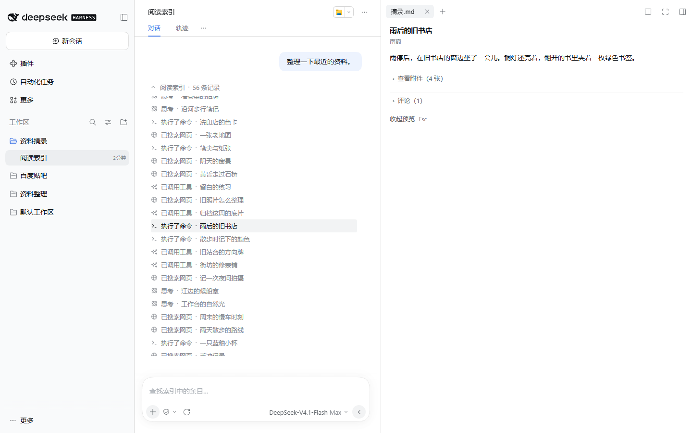
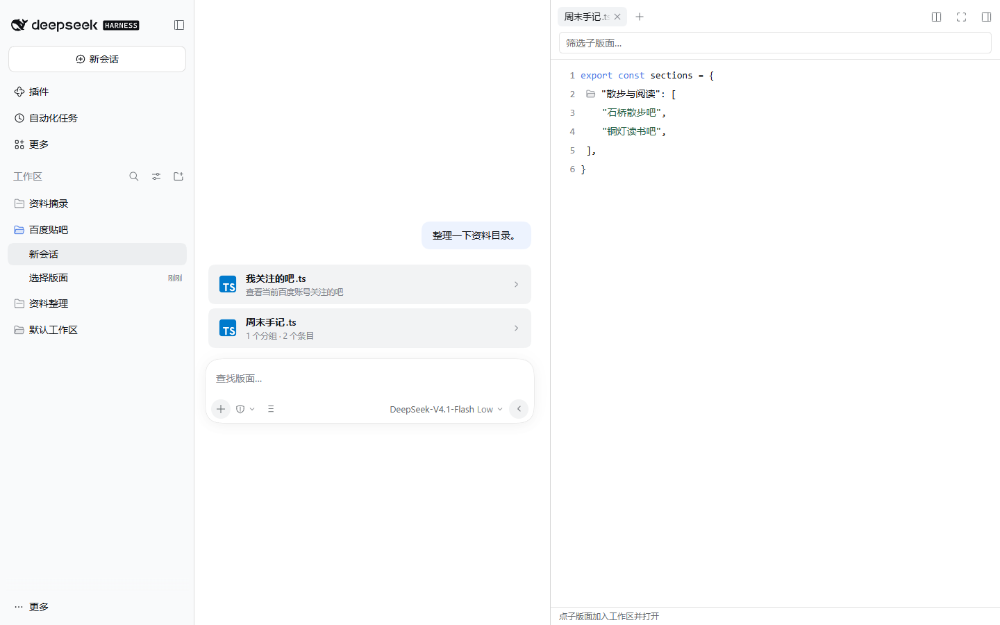

# 摸鱼办 · DSH Moyu

在 DeepSeek Harness（DSH）的工作区里，用文字索引刷小红书、逛贴吧、看 NGA。装好后，点左栏 **资料摘录 → 阅读索引** 就能打开小红书推荐。想看论坛，点 **百度贴吧** 或 **资料整理** 右侧的 **新会话（＋）** 选吧、选版面。

## 安装

先下载 [摸鱼办 0.13.0 安装包（.tgz）](https://github.com/CELLOPOI/dsh-moyu/releases/download/v0.13.0/dsh-moyu-0.13.0.tgz)，保留压缩包原样。实测宿主为 **DSH 0.2.2-rc.1**。要看小红书，请在运行 DSH 的电脑上安装 Chrome 或 Edge，扫码窗口也会开在那台电脑上。

**桌面端**打开 **插件 → 添加插件**，在「包名或地址」中填入下载链接，或填安装包在宿主电脑上的绝对路径。点 **安装**，完成后点 **立即启用**。启用后，插件列表里会显示 **摸鱼办**。

**Web 端**在宿主上打开终端，进入安装包所在目录，运行下面的命令。如果 `dsh web` 正在运行，先停止旧进程，再启动。桌面和 Web 分别安装、启用。

```sh
dsh plugin --profile web add ./dsh-moyu-0.13.0.tgz
dsh web
```

## 第一次打开

| 左栏工作区 | 可以做什么 | 什么时候需要登录 |
| --- | --- | --- |
| 资料摘录 · 小红书 | 浏览首页推荐，在右栏读笔记、看图或视频、展开评论 | 游客可读的批次由官网决定。个性化推荐和官网要求验证时，在宿主上扫码 |
| 百度贴吧 | 按吧名查找，读公开帖子和楼中楼，自建选吧目录 | 查看「我关注的吧」时用百度 App 扫码。公开读帖可以匿名 |
| 资料整理 · NGA | 从分类或编号打开版面与合集，读帖、同步收藏、引用回帖 | 收藏和回帖需要连接 NGA 账号，部分版面也要求验证身份 |

### 阅读小红书推荐

点 **资料摘录 → 阅读索引**，再点一个标题。主区保持在选中的那一行，右栏的 **摘录.md** 显示作者和正文。点 **查看附件** 才会加载图片或视频，点 **评论** 单独读评论。按 **Esc** 收起右栏，焦点回到原条目，可以接着往下滚。



*界面示意，条目为虚构。*

输入栏可按标题或作者筛选已读条目。滚近列表底部会续读，也可以点输入栏 **＋ → 读取下一批**。权限按钮旁的 **刷新推荐** 会重新读取首页，成功后回到顶部。刷新失败时仍可读原索引。需要登录时，点提示里的扫码按钮，或用 **＋ → 连接来源（打开官网扫码窗口）**。

### 逛百度贴吧

点 **百度贴吧 → 新会话（＋）**。新装时，主区只有 **我关注的吧.ts**。想直接读一个吧，点输入栏的 **查找版面…**，输入吧名（如 `linux`）或含 `kw` 的贴吧主页链接，再点 **查找并打开**。从该吧的 **讨论索引** 点标题读帖，点楼层下的 **楼中楼** 看子回复。贴吧输入栏可记本地草稿。

想从关注列表里选，点 **我关注的吧.ts**，扫码并在手机上确认，然后在右栏点一个吧。选中的吧会加入左栏。想自己整理，点输入栏 **＋ → 编辑选吧目录… → 新建分类**，填分类名，再用 **新建分组 → 添加吧 → 保存目录**。新分类随即出现在主区，点卡片可在右栏选吧。



*界面示意，条目为虚构。「周末手记」是用户创建的分类。*

### 看 NGA 和回帖

点 **资料整理 → 新会话（＋）**，点一张分类卡片，再在右栏选版面。知道目标时，也可点 **查找版面…**，输入名称、版面链接、`fid` 版面编号或 `stid` 合集编号。选好后默认打开 **讨论索引**。点标题逐楼阅读，底栏的 **讨论索引** 按钮可返回列表。

点输入栏 **＋ → 连接 NGA 账号** 扫码，收藏版面会同步到工作区。想回应某一楼时，点该楼的 **引用**，在输入栏编辑草稿。**登录后点击「回帖到 NGA」发送箭头，会把草稿公开发到当前原帖。** 收到站点确认后才清除已发送的草稿。若提示「发送结果未确认」，先刷新原帖核对，再决定是否重发。

## 账号、数据与升级

宿主主目录由 `DSH_HOME` 决定，默认是 `~/.dsh`。三站凭据分别交给 DSH 凭据服务保管。小红书使用独立的官网浏览器会话，推荐、正文和媒体授权保存在内存中。切换账号会清掉旧索引，隐藏预览会收起附件并停止播放。

贴吧的普通分类位于 `plugin-workspaces/百度贴吧/分类/`，可以在目录编辑器中查看完整路径，也可以直接编辑 UTF-8 的 `.ts` 文件。NGA 的手动入口、收藏快照和最近选版默认保存在 `plugin-data/dsh-nga-reader/boards/`。使用同一主目录的两端共用这些文件。论坛草稿、引用和阅读位置保存在各阅读端的本地存储中。

**从旧包 `dsh-nga-reader` 升级**（含 0.11.2 和 0.12.0）时，请继续使用原来的 DSH 主目录和阅读端。DSH 会把新旧包识别为两个插件。桌面端先到 **插件 → dsh-nga-reader → 卸载**，再按上面的步骤安装并启用 **摸鱼办**。Web 端先停止 `dsh web`，在新安装包所在目录依次运行以下命令。

```sh
dsh plugin --profile web remove dsh-nga-reader
dsh plugin --profile web add ./dsh-moyu-0.13.0.tgz
dsh web
```

升级会沿用已有分类及顺序、收藏、账号记录、会话编号和真实帖子草稿。上次停在 NGA 示例帖时，会恢复上次真实阅读位置。没有真实记录时会打开讨论索引。示例草稿不会带入同编号的真实帖子。

## 常见问题

**左栏没有三个工作区？** 在当前端的 **插件** 页确认 **摸鱼办** 已启用，然后重新打开桌面端或重启 Web。工作区名称可以折叠，点击名称可展开其中的会话。

**能打开工作区，却读不到内容？** 小红书提示网络错误时，检查宿主上的浏览器能否打开小红书，再点 **重试**。提示登录失效时重新扫码。贴吧关注列表提示「已登录」但同步失败，可在右栏点 **重新同步**。NGA 提示访客受限时，从输入栏的 **＋** 连接账号。遇到站点限流，稍后再读。

**怎么改置顶、跳转或图片缓存？** 打开 **插件 → 摸鱼办**，或点阅读输入栏 **＋ → 阅读设置…**。两处编辑同一份设置，设置页显示文件的实际路径。[默认设置](reader-settings.json) · [配置与分类文件说明](docs/maintenance.md)

反馈问题时，请附上插件和 DSH 版本、使用的站点、桌面或 Web、操作步骤及界面提示。截图请遮住登录二维码和账号信息。[提交 Issue](https://github.com/CELLOPOI/dsh-moyu/issues)

## 从源码打包

在仓库根目录使用 **Node.js 24**，依次运行下面三条命令。`npm pack` 会把安装包写到当前目录，把生成的 `.tgz` 交给 DSH 即可。

```sh
npm ci
npm run build
npm pack
```

修改源码后运行 `npm run build`，再运行 `npm test`。仓库跟踪构建好的 `dist/client.js`，原生工作区测试也会加载它。[维护说明与适配器接口](docs/maintenance.md)

论坛阅读界面的设计参考了 [Linux DO 的 Codex 外观](https://github.com/czm15053/linuxdo-idea-ui/blob/main/linuxdo-codex.user.js)。NGA 协议和扫码流程参考了 [NGA 接口资料](https://github.com/AgMonk/nga-api-doc/blob/main/README_v2.md)、[open-NGA-client](https://github.com/youcai922/open-NGA-client) 和 [jo32 的 NGA Reader](https://github.com/jo32/dsh-nga-reader)。宿主安装方式见 [DSH 插件打包与安装说明](https://github.com/deepseek-ai/deepseek-harness/blob/dsh-v0.2.2-rc.1/docs/user/develop/basic/publish.zh.md)。
